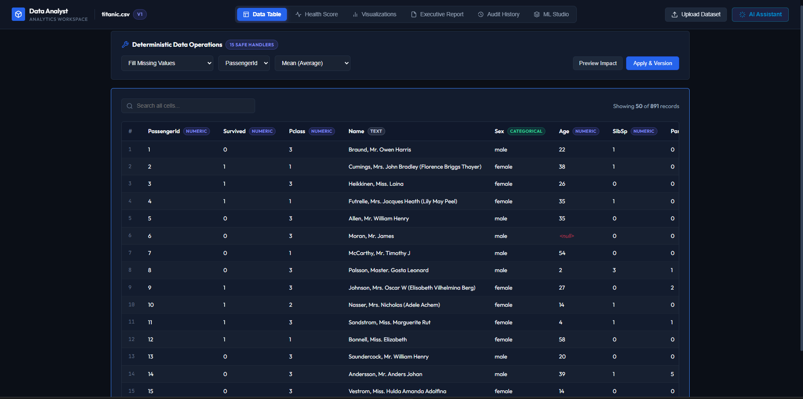
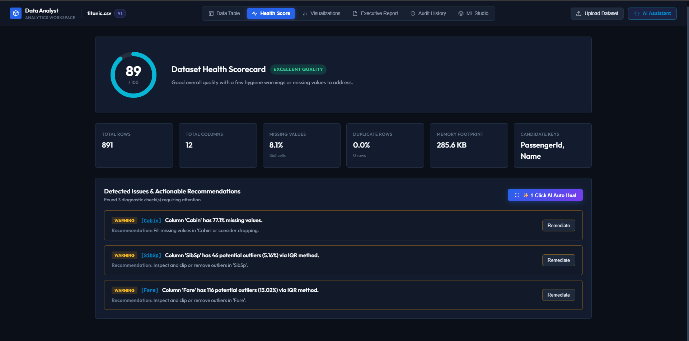
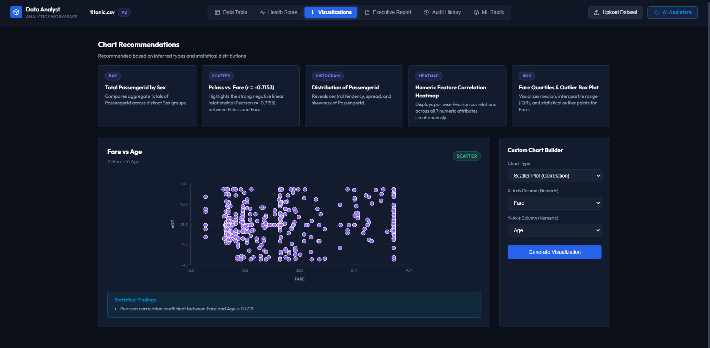
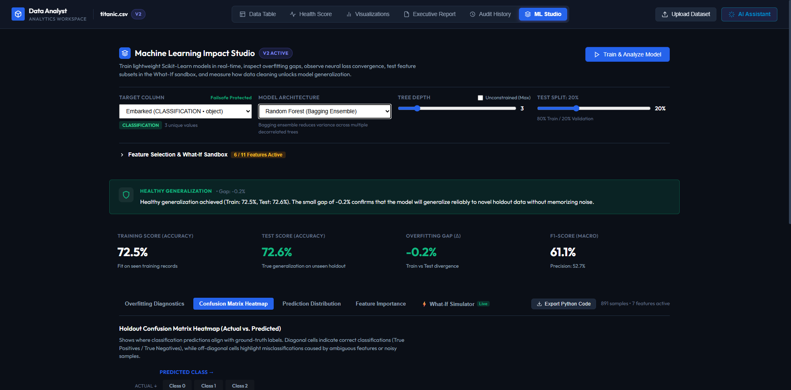
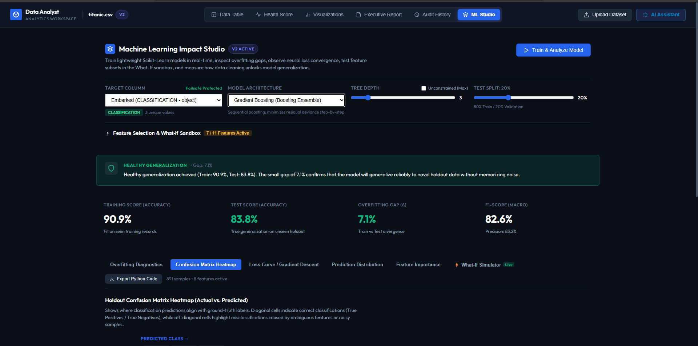
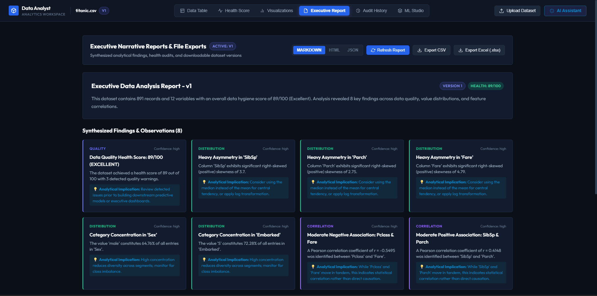
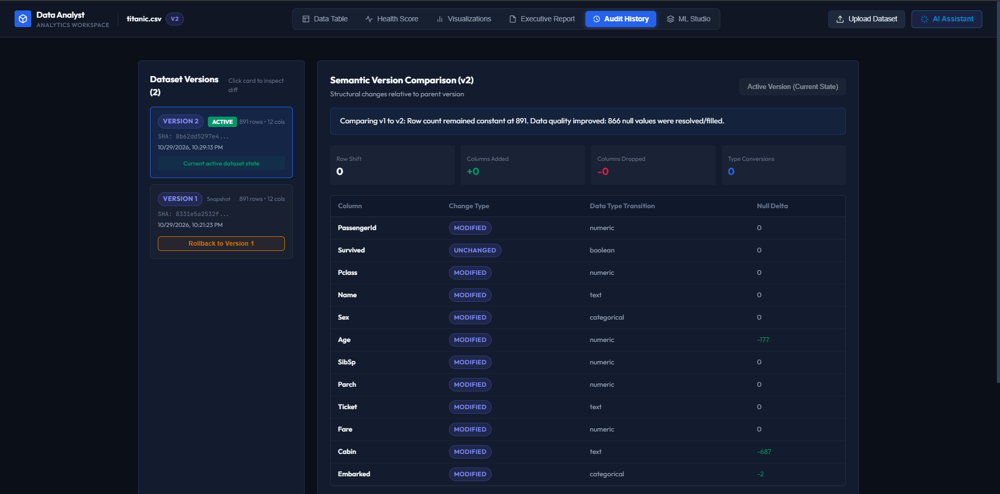

# Spectra — AI Data Analyst 📊

[](https://www.python.org/)
[](https://fastapi.tiangolo.com/)
[](https://reactjs.org/)
[](https://www.typescriptlang.org/)
[](https://scikit-learn.org/)
[](https://opensource.org/licenses/MIT)

Most automated data analysis tools fall into two extremes: either you're writing repetitive boilerplate code in Jupyter notebooks just to spot missing values and train basic models, or you're using black-box "AI agents" that hallucinate Python scripts and distort your dataset.

I built **Spectra** to bridge that gap. It's a full-stack platform that provides automated data profiling, deterministic data cleaning, instant visual analytics, no-code machine learning, and executive reporting. 

Instead of letting an LLM run arbitrary code on your system, the platform uses **deterministic, vectorized transformation pipelines** where AI only translates natural language into structured, human-approvable operations.

---

## 🖥️ Overview



> **Quick Test**: The app comes with the classic **Titanic Survival (891 passengers)** dataset built in. Click **"Load Sample Data"** on the upload modal to immediately test profiling, visualizations, and ML without needing your own CSV file.

---

## 💡 Key Architectural Decisions

Here are a few deliberate engineering choices I made while building this:

1. **Deterministic Cleaning Over Arbitrary Code Execution**:
   Letting an LLM execute raw `exec()` or `eval()` on uploaded data is a major security risk and prone to subtle data distortion. Instead, I designed a catalog of **15 whitelisted, deterministic operations** (median/mean imputation, IQR clipping, type casting, deduplication, etc.) executed via strict Pandas routines with pre-flight dry runs.
2. **Three-Tier AI Reliability**:
   Third-party LLM APIs can be unpredictable during traffic spikes (rate limits, 503 errors, slow responses). The backend uses a multi-tiered resilience orchestrator:
   - **Tier 1**: Google Gemini 2.5 Flash for primary natural language planning.
   - **Tier 2**: Groq LPU Cloud (Llama 3.3 / GPT-OSS) as an automatic failover.
   - **Tier 3**: An offline deterministic rule engine that ensures the platform **never crashes or goes down**, even completely offline.
3. **Sub-Millisecond What-If Simulator**:
   Trained models are kept in memory along with their fitted preprocessing pipelines. This enables users to tweak feature sliders and get real-time single-record predictions in under 2ms without spinning up notebook cells.
4. **Non-Destructive Version History & Lineage**:
   Every transformation step generates an immutable snapshot. Users can inspect exact semantic diffs (what rows were dropped, which values were imputed) and safely roll back to any previous state in one click.

---

## 📸 Feature Walkthrough

### 1. Data Health Scorecard & Quality Profiling
Upload any CSV or Excel file (up to 25MB) to receive an instant **0–100 Health Score**. The engine automatically detects missingness rates, duplicate rows, constant columns, statistical outliers via IQR, and flags sensitive PII leaks (emails, phone numbers, SSNs, credit cards).



---

### 2. Smart Visualizations & Chart Builder
The platform inspects column types and distribution skews to automatically recommend the most informative charts. It features an interactive SVG visualization engine for **Scatter Plots**, **Bar Charts**, **Line Charts**, **Histograms**, **Box Plots (with IQR whiskers and outliers)**, and **Correlation Heatmaps**.



---

### 3. No-Code Machine Learning Studio
Select any target column to train models for **Classification** or **Regression**:
- **Supported Models**: Ridge Regularized Linear Regression, Logistic Regression, Decision Trees, Random Forests, Gradient Boosting (GBDT), K-Nearest Neighbors, Support Vector Machines (SVM), and Multi-Layer Perceptrons (Neural Networks).
- **Diagnostics**: Train vs. Test split evaluation, confusion matrices, ROC/AUC curves, and overfitting gap alerts.



---

### 4. Interactive What-If Parameter Simulator & Loss Curves
Track neural network loss curves across training epochs, view stage-by-stage residual reduction for gradient boosters, and use interactive sliders to test custom hypotheses in real time.



---

### 5. Automated Narrative Reports & Data Export
Synthesizes cleaning logs, health scores, model metrics, and key takeaways into an executive report. You can export cleaned datasets directly to CSV and Excel (`.xlsx`), with built-in OWASP formula injection protection.



---

### 6. Immutable Audit Trail & Version Diffing
Every cleaning action creates an append-only version snapshot. Compare any two versions side-by-side to review column modifications, row count deltas, and value imputations.



---

## 🛡️ Production Security & Hardening

- **OWASP CSV/Excel Formula Injection Defense**: Prepends a safe single quote (`'`) to string values starting with dangerous macro characters (`=`, `+`, `-`, `@`, `\t`, `\r`) during export, defusing spreadsheet command execution.
- **ML Resource Exhaustion (DoS) Clamping**: Enforces strict bounds on user hyperparameters (`n_estimators <= 100`, `max_iter <= 300`, `max_depth <= 25`, `test_size` clamped to `0.05–0.50`) to protect backend CPU threads.
- **In-Memory Sliding Window Rate Limiting**: Tiered protection (30 requests/min on heavy AI/ML endpoints, 120 requests/min on general routes).
- **Information Disclosure Prevention**: Global exception interceptor sanitizes unexpected runtime errors into clean, redacted JSON responses to avoid leaking internal system paths or stack traces.

---

## 🛠️ Tech Stack

- **Frontend**: React 18, TypeScript, Vite, Tailwind CSS, Lucide Icons
- **Backend**: FastAPI, Python 3.11+, Pydantic v2, Uvicorn
- **Data & ML**: Pandas, NumPy, Scikit-Learn, OpenPyXL, Chardet
- **Testing**: Pytest (94 automated unit, integration, and security tests)

---

## 🚀 Getting Started Locally

### 1. Backend Setup
```bash
cd backend
python -m venv .venv

# On Windows:
.venv\Scripts\activate
# On macOS/Linux:
source .venv/bin/activate

pip install -r requirements.txt
python -m uvicorn main:app --reload --port 8000
```
Interactive API documentation will be available at `http://localhost:8000/docs`.

### 2. Frontend Setup
```bash
cd frontend
npm install
npm run dev
```
The user interface will be running at `http://localhost:5173`.

---

## 🐳 Docker Deployment

To build and run the complete full-stack application in a container:

```bash
# Build the image
docker build -t spectra .

# Run container on port 7860
docker run -p 7860:7860 spectra
```

You can also deploy this repository directly to **Hugging Face Spaces** using Docker SDK on port `7860`.

---

## 📄 License

This project is open-source under the [MIT License](LICENSE).
